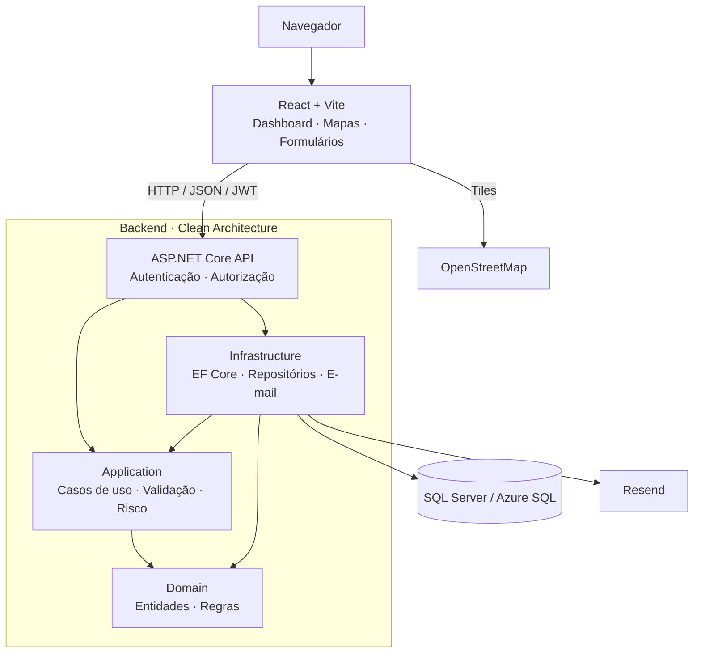

# S.E.N.T.R.A.

**Sistema Estratégico de Navegação, Tráfego e Resposta Ativa**

Uma plataforma web para **gestão, monitoramento e prevenção de problemas na infraestrutura urbana**. O S.E.N.T.R.A. reúne equipamentos, agentes, manutenções e informações geográficas em uma central de operações, com indicadores e recomendações fundamentadas em dados.

Desenvolvido por uma equipe de três estudantes para o **DSIN Coder Challenge 2026 — F.O.G.O. / PROMETHEUS**.

**Tecnologias:** C# · .NET 10 · ASP.NET Core · React 19 · Vite 8 · SQL Server · Leaflet · Azure

<!-- Adicionar aqui imagens reais da Dashboard, da Central de Operações e da Cidade Preditiva antes da entrega. Não usar capturas com dados privados. -->

## O desafio: três partes, uma plataforma

| Etapa | O que foi implementado |
| --- | --- |
| **01. Inventário Inteligente** | Cadastro, consulta e atualização de equipamentos urbanos e agentes; localização por endereço e GPS; características específicas por tipo; situação operacional, vínculos e manutenção. |
| **02. Central de Operações** | Dashboard com indicadores, mapa interativo, marcadores por tipo e situação, filtros, acompanhamento dos recursos, alertas operacionais e mapas de calor de ocorrências, falhas e riscos. |
| **03. Cidade Preditiva** | Análise explicável de risco por equipamento e região, fatores e histórico de falhas, identificação de anomalias e recomendações preventivas, incluindo a possibilidade de planejar manutenções a partir de recomendações. |

O módulo preditivo utiliza **regras heurísticas explicáveis**. Suas pontuações representam prioridade relativa, não probabilidades calibradas nem previsões produzidas por um modelo de machine learning.

## Além do enunciado

Além das funcionalidades centrais do desafio, a equipe implementou recursos voltados à segurança, à operação e à experiência de uso:

| Diferencial | Implementação |
| --- | --- |
| **Implantação em nuvem** | Backend no Azure App Service, banco Azure SQL e frontend no Azure Static Web Apps. |
| **CI/CD** | Workflows do GitHub Actions para publicação dos serviços, com verificações de compatibilidade entre schema, API e frontend. |
| **Interface responsiva** | Telas adaptadas a diferentes tamanhos de dispositivo, incluindo celular, tablet e desktop. |
| **Autenticação e permissões** | Login com JWT, cinco perfis de acesso e autorização efetiva no backend. |
| **Administração de usuários** | Cadastro, consulta, edição, ativação/desativação, alteração de cargo, histórico de alterações e revogação de sessões. |
| **Recuperação de senha por e-mail** | Integração com Resend e links temporários de uso único, sem envio de senhas por e-mail. |
| **Vínculos operacionais** | Associação entre contas e agentes e gerenciamento de vínculo entre agentes e veículos/equipamentos móveis. |
| **Atualização periódica** | Atualização de informações operacionais com tratamento de falhas e sinalização de dados desatualizados. |
| **Mapa de calor interativo** | Visualização geográfica com filtros, zoom e interação por toque. |
| **Ambiente DEMO isolado** | Cenários reproduzíveis com banco local, dados sintéticos e contas de avaliação, separados da produção. |
| **Testes automatizados** | **591 testes aprovados** na última execução local: 374 no backend e 217 no frontend. |

A implantação na Azure foi realizada, mas **o endereço público da aplicação não será divulgado durante a etapa de avaliação**. O repositório contém as instruções para executá-la localmente. A ausência do link público não substitui os controles de autenticação e autorização do sistema.

## Tecnologias

| Área | Tecnologias |
| --- | --- |
| **Backend** | C#, .NET 10, ASP.NET Core, Entity Framework Core, FluentValidation |
| **Frontend** | React 19, JavaScript, Vite 8, Leaflet, React Leaflet, leaflet.heat |
| **Banco de dados** | SQL Server / Azure SQL |
| **Autenticação e segurança** | JWT, BCrypt, autorização por perfis (RBAC) |
| **E-mail** | Resend, integrado exclusivamente ao backend |
| **Infraestrutura** | Azure App Service, Azure SQL, Azure Static Web Apps, GitHub Actions |
| **Qualidade** | xUnit, `node:test`, ESLint e testes de integração locais |

## Visão da arquitetura

O backend segue **Clean Architecture**, com responsabilidades separadas entre API, aplicação, domínio e infraestrutura. O frontend acessa a API por HTTP; não se conecta diretamente ao banco de dados.



A versão detalhada, incluindo testes, deploy e ambiente DEMO, está no [diagrama completo](docs/diagrams/arquitetura-sentra.mmd) e na [documentação de arquitetura](docs/arquitetura.md).

## Como executar localmente

O caminho mais simples para conhecer os módulos com dados preenchidos é a **DEMO local isolada**. Para desenvolver com um banco próprio e uma conta administrativa nova, utilize a instalação completa.

### 1. Pré-requisitos

Para seguir os procedimentos documentados no repositório, recomenda-se **Windows com PowerShell** e:

- **.NET SDK 10** e `dotnet-ef` compatível com EF Core 10;
- **Node.js compatível com Vite 8** (na linha 22, versão 22.12 ou superior) e npm;
- **SQL Server LocalDB** para o banco de demonstração;
- **Git**, para obter o repositório.

### 2. Baixar e preparar o projeto

Abra o **PowerShell** e execute:

```powershell
git clone https://github.com/yBreno/S.E.N.T.R.A.git
cd S.E.N.T.R.A

dotnet restore backend/Solution/Solution.slnx
dotnet build backend/Solution/Solution.slnx --no-restore
npm.cmd ci --prefix frontend
```

### 3. Escolher um modo de execução

**Opção A — DEMO local (recomendada para avaliação)**

Siga o **[guia de preparação da DEMO](docs/demo/preparacao-ambiente.md)**. Ele orienta a criar **um banco LocalDB novo e isolado**, aplicar as migrations existentes, carregar dados fictícios, provisionar contas de teste e iniciar API e frontend.

A demonstração inclui **12 equipamentos, 9 agentes, 79 registros operacionais e 5 contas fictícias**. Não há senha padrão: o procedimento solicita uma senha privada para as contas do ensaio. A DEMO inicia em modo de leitura, com uma interação de aceite preventivo opcional e controlada.

Ao concluir a preparação, a interface fica disponível em `http://127.0.0.1:5173`, conectada à API local na porta `5180`. **Não utilize dados reais nem a conexão do Azure nesse procedimento.**

**Opção B — Ambiente de desenvolvimento**

Siga o **[guia de instalação completa](docs/instalacao.md)** para criar um banco local novo, aplicar as **7 migrations já existentes**, configurar as variáveis privadas, cadastrar o primeiro Admin e executar a aplicação.

Após configurar e iniciar a API na porta `5129`, abra outro terminal PowerShell para iniciar o frontend:

```powershell
$env:VITE_API_BASE_URL = 'http://127.0.0.1:5129'
$env:VITE_DEMO_MODE = 'false'
npm.cmd --prefix frontend run dev -- --host 127.0.0.1 --port 5173 --strictPort
```

Acesse `http://127.0.0.1:5173`. A API e o frontend devem estar em execução simultaneamente.

> **Atenção:** nunca publique senhas, tokens, chaves JWT, chaves do Resend ou connection strings privadas. Variáveis `VITE_*` são visíveis no navegador e não devem conter segredos. O projeto não executa migrations automaticamente ao iniciar a API.

## Testes e qualidade

Depois de preparar as dependências, execute na raiz do repositório:

```powershell
dotnet build backend/Solution/Solution.slnx
dotnet test backend/Tests/Tests.csproj
node --test frontend/tests/*.test.js
npm.cmd --prefix frontend run lint
npm.cmd --prefix frontend run build
```

Na última validação local, em **25/10/2026**, foram aprovados **374 testes backend e 217 testes frontend**, sem falhas. Também passaram os builds .NET/Vite e o ESLint. Esses testes não substituem a verificação do ambiente publicado.

## Organização do repositório

```text
S.E.N.T.R.A/
├── backend/
│   ├── Api/              API HTTP, autenticação e configuração
│   ├── Application/      Casos de uso, validações e análise preditiva
│   ├── Domain/           Entidades e regras de negócio
│   ├── Infrastructure/   Banco de dados, repositórios e e-mail
│   ├── DemoData/         Preparação de dados sintéticos
│   ├── DemoAdmin/        Contas locais de demonstração
│   ├── Tests/            Testes backend
│   └── Solution/         Solução .NET
├── frontend/             Aplicação React, componentes e testes
├── scripts/demo/         Inicializador da DEMO local
├── docs/                 Guias, diagramas e documentação técnica
└── .github/workflows/    Publicação dos serviços
```

## Documentação

- [Instalação completa](docs/instalacao.md) — configuração do banco, API, Admin e frontend.
- [Ambiente DEMO](docs/demo/preparacao-ambiente.md) — execução com dados fictícios e sem acesso à produção.
- [Arquitetura](docs/arquitetura.md) — camadas, contratos, segurança e decisões técnicas.
- [Frontend](frontend/README.md) — detalhes da interface, configuração e build.
- [Índice da documentação](docs/README.md) — outros guias e relatórios.

---

Projeto desenvolvido para o **DSIN Coder Challenge 2026 — F.O.G.O. / PROMETHEUS**.
