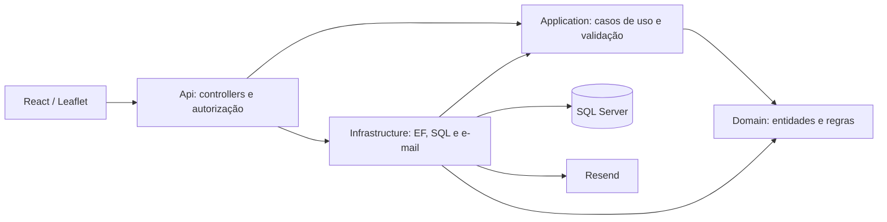

# Arquitetura e contratos operacionais

S.E.N.T.R.A. é um monólito modular em Clean Architecture. Não utiliza Identity:
autenticação existente permanece JWT/BCrypt, com estado e versão persistidos.

| Camada | Responsabilidade concreta |
| --- | --- |
| Domain | Oito tipos de equipamentos, estados/transições, agentes/categorias, manutenção e contratos de persistência |
| Application | DTOs, validators, mapeamentos UTC, serviços de operação, cálculo explicável de risco, autenticação e recuperação |
| Infrastructure | TPH, índices/FKs, repositórios, bloqueios transacionais SQL, migrations e transporte Resend |
| Api | Rotas, JWT/RBAC, CORS, erros HTTP, bootstrap privado e workers explicitamente controlados |
| Frontend | Transporte HTTP, whitelist de dados, permissões de interface, formulários, navegação, polling e mapa |

Infrastructure referencia Application/Domain; Domain não depende da API ou do EF.
Os contratos públicos existentes são reutilizados. Nesta revisão não houve nova
migration, renomeação de enum persistido ou mudança no discriminador TPH.

## Três partes do desafio

**Inventário:** CRUD de equipamentos/agentes, endereço completo, GPS, características
do tipo, categoria de uso, vínculos e manutenção. Balança e controlador IoT de
cancela usam Sensor; táxi/escolar/viatura usam categorias dos veículos existentes.
Não se simulou atuação física da cancela. Vínculo UserId identifica o profissional
da conta; não cria credenciais nem muda UserRole.

**Central:** indicadores e camadas leem dados persistidos. O polling preserva a
última resposta válida e sinaliza desatualização por fonte; os ciclos não são um
snapshot transacional único. Marcadores distinguem tipos/categorias e estado;
o selo de risco não substitui a situação operacional. Tiles são externos ao sistema.

**Cidade Preditiva:** soma heurística de fatores explicados por equipamento/bairro,
histórico, anomalias e estimativa descritiva de MTBF. Índice 85/100 não é probabilidade
de 85%, modelo treinado ou previsão calibrada. Dados insuficientes e janelas sem
cobertura são sinalizados. Aceitar recomendação de equipamento planeja manutenção;
aceitar reforço regional não despacha profissionais automaticamente.

## Segurança e permissões

| Cargo | Inventário | Central / preditiva | Manutenção | Usuários |
| --- | --- | --- | --- | --- |
| Admin | Gestão | Consulta, análise e decisões | Gestão | Exclusivo: gestão e reset administrativo |
| OperationManager | Gestão | Consulta, análise e decisões | Gestão | Negado |
| CentralOperator | Consulta; ações de estado/localização autorizadas | Monitoramento e análise manual; sem aceite/descarte | Negado | Negado |
| MaintenanceTechnician | Equipamentos e ações autorizadas | Risco por equipamento, MTBF e recomendações de manutenção via API | Gestão | Negado |
| Agent | Próprio profissional/posição pela API | Sem monitoramento global | Negado | Negado |

UserRole tem somente esses cinco valores. AgentRole tem TrafficAgent,
MunicipalGuard e PoliceOfficer. As políticas efetivas estão nos controllers;
ocultar botão não substitui autorização. O técnico tem navegação Equipamentos e
Manutenções; Agent não tem painel interno completo no frontend.

JWT verifica assinatura, emissor, destinatário, expiração, usuário ativo, cargo e
AuthVersion no banco. Alteração de acesso revoga tokens; o último Admin ativo é
protegido. Há janela para requisições já autorizadas terminarem durante revogação;
mutações administrativas revalidam o ator sob lock.

Administração/recuperação usam o mesmo bloqueio SQL, revisão otimista e transação.
Reset usa segredo aleatório de 256 bits, hash no banco, validade curta, uso único,
limites compartilhados e auditoria. O provedor não recebe senha permanente.
O email é enviado fora do lock. A fila é limitada e volátil; reinícios podem exigir
nova solicitação. O transporte de teste é recusado em produção.

## Persistência, tempo e concorrência

- Sete migrations oficiais, schema aditivo e SQL revisado. API não migra no startup.
- datetime2 não preserva DateTime.Kind. DTOs operacionais convertem a convenção UTC
  na saída, sem alterar o instante salvo. A interface apresenta no fuso do navegador.
- Índices únicos impedem duas ordens pendentes por equipamento e duplicação do
  vínculo de recomendação; repetição sequencial de aceite retorna a decisão existente.
  Uma repetição concorrente pode retornar 409 e exigir atualização da tela.
- Análises/geradores preditivos usam coordenação SQL compartilhada. Consultas não
  criam recomendações. Simulation e PredictiveAutomation são desabilitadas por padrão.
- Cadastros operacionais não possuem revisão otimista em todos os fluxos; edições
  simultâneas exigem coordenação dos operadores. Os fluxos legados de ocorrência e
  telemetria têm múltiplos SaveChanges: não se afirma atomicidade global para eles.

Erros tratados pelo middleware retornam mensagens controladas e no-store. Logs da aplicação registram tipo
da falha e identificação de requisição, sem anexar mensagens de exceção privadas.
O filtro não substitui a revisão de logs/telemetria privados do ambiente de hospedagem.

## Limites e operação

Não há endpoint dedicado de health/readiness; site HTTP 200 e disponibilidade do
envio não comprovam conexão SQL ou entrega SMTP. CORS, segredos, domínio e gates
privados precisam de conferência pelo responsável. O plano de publicação mantém
schema → backend → frontend, sem misturar versões de autenticação incompatíveis.

Tokens ficam temporariamente em sessionStorage; revisar cookies HttpOnly/BFF e
proteções adicionais contra XSS em evolução futura. Não foram adicionadas telas
de relatórios/alertas, telemetria real, ML, despacho automático ou recuperação por
senha temporária.
