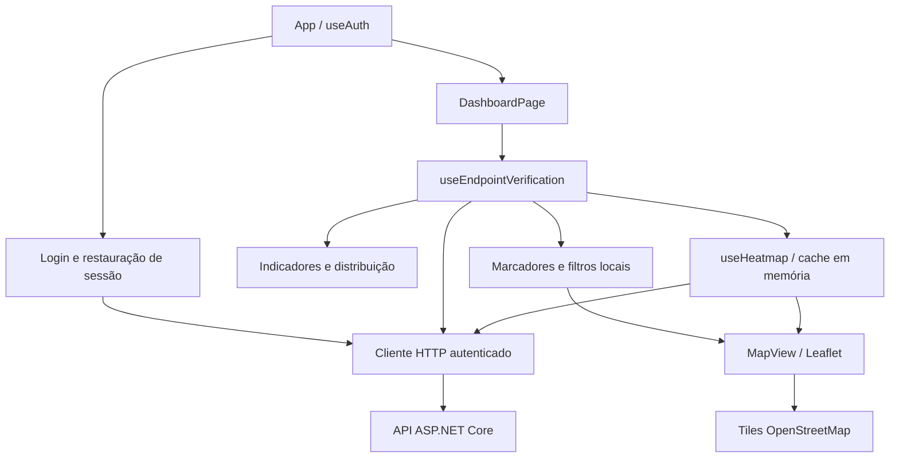

# Frontend S.E.N.T.R.A.

**Sistema Estratégico de Navegação, Tráfego e Resposta Ativa**

## Sumário

- [Apresentação](#apresentação-do-sentra)
- [Tecnologias utilizadas](#tecnologias-utilizadas)
- [Estrutura e arquitetura](#estrutura-do-frontend)
- [Funcionalidades implementadas](#funcionalidades-implementadas)
- [Responsividade e acessibilidade](#responsividade-e-acessibilidade)
- [Integração com o backend](#integração-com-o-backend)
- [Execução local](#execução-local)
- [Organização do código](#organização-do-código)
- [Funcionalidades pendentes](#funcionalidades-pendentes)
- [Testes e qualidade](#testes-e-qualidade)
- [Diagnóstico de problemas](#diagnóstico-de-problemas)

## Apresentação do S.E.N.T.R.A.

O S.E.N.T.R.A. é uma plataforma de monitoramento e gestão de operações urbanas desenvolvida
para o desafio **F.O.G.O. — Ferramenta Onisciente de Gestão e Operações**, da DSIN/PROMETHEUS.
O projeto reúne Inventário Inteligente da Cidade, Centro de Operações da Cidade e Cidade Preditiva.

Este frontend implementa o Centro de Operações: autenticação, indicadores, mapa de equipamentos
e agentes e análise geográfica por mapa de calor. O backend ASP.NET Core fornece os dados e
aplica as regras de negócio e permissões. Ter um endpoint no backend não significa que sua
respectiva tela de gestão já existe. Consulte também o [README principal](../README.md).

## Tecnologias utilizadas

Versões conferidas nas dependências instaladas durante esta atualização:

| Tecnologia | Versão | Uso |
| --- | --- | --- |
| React e React DOM | 19.3.1 | Componentes e renderização da interface |
| Vite | 8.3.4 | Servidor de desenvolvimento e build |
| React Leaflet | 5.0.0 | Integração do mapa com os componentes React |
| Leaflet | 1.9.4 | Cartografia, navegação, marcadores e popups |
| leaflet.heat | 0.2.0 | Camada de calor em canvas |
| ESLint | 10.13.0 | Análise estática de JavaScript e JSX |
| Plugin React do Vite | 6.1.2 | Integração React no Vite |
| eslint-plugin-react-hooks | 7.1.1 | Regras de hooks e efeitos React |
| eslint-plugin-react-refresh | 0.5.7 | Verificação dos módulos usados pelo Fast Refresh |

O código utiliza **JavaScript/JSX e CSS**, sem migração para TypeScript. Os testes usam
`node:test` e `node:assert/strict`. O transporte HTTP utiliza `fetch` nativo.
As versões reproduzíveis estão no `package-lock.json`; React e Vite possuem intervalos
no manifesto, enquanto as três bibliotecas de mapa estão fixadas no `package.json`.

| Recurso | Aplicação no projeto |
| --- | --- |
| CSS nativo | Tema por variáveis, Grid, Flexbox, media queries, `clamp()` e unidades `dvh` |
| SVG | Ícones da interface e marcadores; gráfico de distribuição sem biblioteca adicional |
| OpenStreetMap | Cartografia real por tiles HTTPS, carregados pelo Leaflet |
| Canvas 2D | Renderização da camada de calor pelo leaflet.heat |
| `fetch` e `AbortController` | Requisições autenticadas e cancelamento dos fluxos pendentes |
| `sessionStorage` | Persistência temporária da sessão na aba |
| `Intl` e `Date` | Números, percentuais, datas em português e conversão de datas locais para UTC |
| `ResizeObserver` e `requestAnimationFrame` | Ajuste das dimensões do mapa quando o layout muda |
| `matchMedia` | Comportamento do menu mobile e abertura inicial dos filtros |
| HTML semântico e ARIA | Formulários, navegação, estados de erro/carregamento e controles acessíveis |

Ambiente utilizado na última conferência local: **Node 26.7.0 e npm 11.16.0**.
Esses valores descrevem o ambiente verificado; os requisitos para execução estão abaixo.
As dependências `@types/react` e `@types/react-dom` auxiliam as ferramentas de desenvolvimento
e não significam que a aplicação utiliza TypeScript. A API ASP.NET Core .NET 10 é um serviço
separado: o React acessa HTTP, sem conexão direta ao SQL Server.

## Estrutura do frontend

```text
frontend/
├── public/brand/                     Logos oficiais, incluindo a versão transparente
├── src/
│   ├── main.jsx                      Inicialização com React StrictMode
│   ├── App.jsx                       Login, restauração e acesso à dashboard
│   ├── App.css / index.css           Estilos da aplicação e tema global
│   ├── config/api.js                 Validação da URL da API
│   ├── pages/
│   │   └── DashboardPage.jsx         Página operacional e navegação lateral
│   ├── components/
│   │   ├── Brand.jsx / Brand.css     Logo e nome completo compartilhados
│   │   ├── LoginForm.jsx             Formulário de autenticação
│   │   ├── auth/                     Composição visual e estilos do acesso
│   │   ├── dashboard/                Menu, cabeçalho, indicadores e painéis laterais
│   │   └── map/                      Mapa, marcadores, filtros, calor e inspeção
│   ├── hooks/                        Estado e integração com serviços
│   └── services/                     HTTP, autenticação, sessão e consultas
├── tests/                            Testes automatizados com Node
├── .env.example                      Exemplo de configuração pública
├── index.html                        Entrada HTML e política de referência
├── vite.config.js                    Configuração do Vite
└── eslint.config.js                  Regras de análise estática
```

Os estilos específicos acompanham as páginas/componentes. O protótipo HTML antigo foi
removido; o mapa de calor oficial é o integrado ao React.

| Hook | Responsabilidade |
| --- | --- |
| `useAuth` | Login, logout, restauração, expiração e controle visual de acesso |
| `useEndpointVerification` | Rodada compartilhada de consultas, atualização manual e cancelamento |
| `useOperationalMarkers` | Preparação e filtragem local dos marcadores |
| `useMarkerInspection` | Seleção válida de equipamento ou agente |
| `useHeatmap` | Métrica, filtros, visibilidade e recurso de consultas de calor |

### Componentes e responsabilidades

| Componente | Responsabilidade |
| --- | --- |
| `App` | Escolhe apresentação de acesso, restauração, acesso indisponível ou dashboard |
| `Brand` | Compartilha logo transparente e nome completo do sistema |
| `AuthLayout` / `LoginForm` | Layout responsivo de acesso e formulário com estados de envio/erro |
| `DashboardPage` | Integra consultas compartilhadas, navegação lateral e estado do calor |
| `DashboardSidebar` / `DashboardHeader` | Menu, identificação do usuário, data e atualização manual |
| `DashboardIndicators` | Cinco indicadores e estados de carregamento/erro/dados anteriores |
| `NetworkStatus` | Rosca SVG e legenda da distribuição de equipamentos por estado |
| `RecentAlerts` | Informa que o painel ainda não possui integração de alertas |
| `DashboardIcon` | Ícones SVG locais utilizados pela interface |
| `MapView` | Mapa base, composição das camadas, filtros e estado dos tiles |
| `EquipmentMarkers` / `AgentMarkers` | Marcadores separados por categoria, com seleção e popup |
| `MapLayersControl` | Visibilidade independente, contadores e legenda das camadas |
| `OperationalFilters` | Campos de filtragem local e limpeza de filtros |
| `MapPopup` / `OperationalRecordDetails` | Detalhes operacionais reutilizados no mapa e na inspeção |
| `RecordInspection` | Painel do registro selecionado, com opção de fechar |
| `HeatmapControls` / `HeatmapLayer` | Consulta das métricas e desenho da camada de calor |

### Fluxo de dados



Os componentes recebem os dados preparados pelos hooks e serviços. A filtragem operacional
não faz consultas próprias; equipamentos, agentes e indicadores reutilizam a mesma rodada.
O calor pode compartilhar Incidents padrão ou consultar sua própria combinação de filtros.
O desenho do mapa e o carregamento dos tiles são independentes das requisições à API.

## Funcionalidades implementadas

### Identidade visual e experiência

A identidade utiliza a logo oficial **sem fundo** em `public/brand/sentra-logo.png`,
compartilhada por `Brand.jsx` no login e no topo da sidebar. Abaixo da marca aparece
**Sistema Estratégico de Navegação, Tráfego e Resposta Ativa**. A versão original com
fundo foi organizada como `public/brand/sentra-logo-background.png` e não é utilizada na interface.

| Cor | Papel na interface |
| --- | --- |
| `#111316` | Fundo principal |
| `#171B1F` | Navegação e área de apresentação do login |
| `#20252A` | Painéis operacionais |
| `#FFCC00` | Ação principal, seleção e foco |
| `#F5F5F5` | Texto principal |
| `#9CA3AF` | Texto de apoio |

O login tem duas colunas no desktop: marca e apresentação da operação à esquerda,
formulário de acesso à direita. No celular, a composição vira uma coluna com marca,
nome completo e formulário. Os campos têm 50 px de altura, rótulos visíveis, autocomplete
nativo e fonte de 16 px; carregamento e erros mantêm o tratamento da autenticação existente.
Não foram adicionadas fontes externas, bibliotecas ou animações de entrada.

`auth/AuthLayout.jsx` organiza apenas a apresentação. A lógica de login, restauração,
expiração, logout e autorização permanece nos hooks e serviços existentes. Os estilos
do acesso são específicos dessa tela para preservar os controles do mapa e da dashboard.
A sidebar mantém sua versão recolhida no desktop e o menu com fechamento por teclado
no celular; quando recolhida, a descrição fica oculta e a janela da logo mostra apenas
o símbolo oficial, sem alterar o arquivo original.

Na limpeza visual, `EndpointVerification.jsx`, sem consumidores, foi removido. A análise
final dos imports a partir de `main.jsx` confirmou que os **22 componentes JSX restantes**
participam da aplicação; nenhum outro JSX foi excluído.

### Autenticação e sessão

- Login por e-mail/senha integrado ao JWT da API .NET; formulário com carregamento e erro.
- Monitoramento disponível para **Admin**, **OperationManager** e **CentralOperator**.
  Outros papéis recebem uma mensagem de acesso indisponível.
- Sessão em memória e, temporariamente para demonstração, em `sessionStorage` da aba.
  Não há uso de `localStorage`, cookies de autenticação ou refresh token.
- Após F5, o frontend verifica formato e validade da sessão e consulta `GET /api/dashboard`
  com o JWT. A dashboard só aparece depois da aceitação dessa consulta protegida.
- A validade efetiva é a menor entre `exp` do JWT e `expiresAt` da resposta de login.
  A sessão armazenada é vinculada à URL da API, evitando sua reutilização ao trocar de ambiente.
- Logout, expiração e respostas 401 dos fluxos autenticados removem a sessão local.
  Uma falha de restauração também exige novo login; cancelamentos não restauram respostas antigas.
- Somente token, validade e nome/papel de apresentação são persistidos. Senha, CPF e dados
  operacionais não são guardados nesse registro. Se o armazenamento estiver bloqueado,
  o login funciona apenas em memória e não sobrevive ao F5.

**Segurança:** `sessionStorage` pode ser lido ou adulterado por scripts em caso de XSS.
Essa persistência é uma alternativa temporária, não equivalente a cookies HttpOnly.
Decodificar claims ou verificar papéis no navegador não valida a assinatura nem concede
permissão: autenticação e autorização efetivas continuam no backend. O logout local não
revoga um JWT já emitido no servidor; ele remove a sessão deste cliente.

### Dashboard

A página mostra nome/papel do usuário e cinco indicadores baseados em `/api/dashboard`:
total cadastrado, operacionais, indisponíveis, disponibilidade e agentes ativos.

| Indicador | Origem ou cálculo |
| --- | --- |
| Equipamentos cadastrados | `totalEquipments` |
| Equipamentos operacionais | `byStatus.Operational` |
| Equipamentos indisponíveis | Soma de `byStatus.Malfunctioning`, `byStatus.UnderMaintenance` e `byStatus.Stolen` |
| Disponibilidade | `availabilityRatePercent`, fornecido pelo backend |
| Agentes ativos | `activeAgents`, fornecido pelo backend |

São números gerais da API;
os filtros do mapa não recalculam esses totais. Nenhuma variação temporal é inventada.

Há estados de carregamento, erro e ausência de dados, além do botão **Atualizar dados**.
Durante uma atualização ou falha, a última resposta válida é preservada com aviso de possível
desatualização. A seção visual de verificação de endpoints foi removida; os serviços e
consultas compartilhadas continuam sendo utilizados pelos indicadores e pelo mapa.

A sidebar pode ser recolhida no desktop e aberta como menu no celular. Seções sem telas
implementadas são identificadas como **Em breve**. A coluna direita apresenta um estado
informativo para alertas ainda não integrados e uma rosca SVG da distribuição real de
equipamentos por estado, sem dependência de gráficos ou novas consultas.

O cabeçalho informa a data local e identifica o usuário por suas iniciais. O estado
**Sistema operacional** depende do sucesso da rodada compartilhada de consultas, não de
uma sondagem de saúde da infraestrutura. O botão de sino leva ao painel de alertas;
ele não recebe notificações em tempo real. O rodapé informa o horário da última tentativa
de atualização, que não deve ser confundido com o horário de sucesso de cada recurso.

### Navegação lateral

| Grupo | Itens atuais | Comportamento |
| --- | --- | --- |
| Visão geral | Dashboard | Retorna ao início da página operacional |
| Gestão operacional | Equipamentos, Agentes, Manutenções | Desabilitados, identificados como **Em breve** |
| Monitoramento | Mapa operacional | Navega até o mapa e desativa a camada de calor |
| Monitoramento | Mapa de calor | Navega até seus controles e ativa a camada de calor |
| Monitoramento | Alertas e ocorrências | Desabilitado, identificado como **Em breve** |
| Inteligência | Cidade preditiva, Relatórios e indicadores | Desabilitados, identificados como **Em breve** |
| Sistema | `Usuarios(Apenas ADM)` | Espaço reservado e desabilitado para o futuro cadastro de usuários pelo administrador |
| Ação de sessão | Sair | Encerra a sessão e volta ao login |

**Empresas** e **Perfil do usuário** foram removidos do menu. O antigo item
**Configurações** foi substituído por `Usuarios(Apenas ADM)`, com ícone de usuário.
O rótulo descreve a funcionalidade planejada: a criação de usuários ainda não está
implementada. Não há formulário, chamada de cadastro ou página de administração nesta versão.

As opções ativas usam âncoras na mesma dashboard. Retornar a Dashboard não redefine filtros
nem a visibilidade das camadas. O menu mantém a identificação do usuário e seu papel;
a opção de recolher é oferecida no desktop, enquanto o celular utiliza um menu sobreposto.

### Mapa operacional

- `MapContainer` centrado inicialmente em São Paulo (`-23.5505`, `-46.6333`), com zoom 12.
- Navegação por arraste, controles de zoom, roda do mouse e gesto de pinça em dispositivos compatíveis.
- Tiles oficiais `https://tile.openstreetmap.org/{z}/{x}/{y}.png`, com atribuição aos contribuidores.
- Política `strict-origin-when-cross-origin` no HTML e no TileLayer para enviar a origem
  legítima nas requisições aos tiles. A correção do bloqueio por ausência de Referer está
  implementada; a validação publicada foi informada pelo responsável do projeto.
- Altura explícita e responsiva, CSS do Leaflet e observação de redimensionamento do contêiner.
- Equipamentos com ícones quadrados e agentes com ícones circulares, diferenciados por estado.
- Popups e painel de inspeção reutilizam detalhes operacionais: tipo, marca/modelo, série,
  estado e bairro do equipamento; nome, matrícula, função, disponibilidade, bairro e horário
  da localização do agente. Não exibem CPF nem oferecem edição.
- Coordenadas devem ser números finitos, latitude entre −90 e 90 e longitude entre −180 e 180.
  Zero é válido; valores nulos ou strings numéricas são descartados. Identificadores vazios
  ou duplicados também não geram marcadores.
- Textos da API são renderizados com JSX. Estados desconhecidos recebem apresentação neutra.
  `TrafficAgent` é apresentado como **Agente de trânsito**; datas seguem o fuso do navegador.

| Categoria | Valores do contrato e rótulos apresentados |
| --- | --- |
| Equipamentos | `Operational`: Operacional; `Malfunctioning`: Com falha; `UnderMaintenance`: Em manutenção; `Deactivated`: Desativado; `Stolen`: Furtado / roubado; `NotInstalled`: Não instalado |
| Agentes | `Available`: Disponível; `Busy`: Ocupado; `Offline`: Offline |

Os símbolos de equipamentos e agentes são SVG estáticos em `divIcon`; as instâncias são
reutilizadas por categoria/estado. A legenda combina formas, cores e rótulos textuais.
Um clique abre o popup e alimenta o painel de inspeção. Fechar a inspeção limpa a seleção;
filtrar ou desligar a camada também remove seleções que deixaram de estar visíveis.

Equipamentos, agentes e calor têm controles independentes. Atualizações e filtros preservam
a instância, centro e zoom do mapa. Abrir um popup pode ajustar a vista para deixá-lo legível.
A sessão pode sobreviver ao F5, mas filtros e posição do mapa não são persistidos.

### Filtros e contadores

Os filtros de equipamentos combinam **tipo**, **status** e **bairro** por interseção.
Os oito tipos disponíveis são câmera, radar, sensor, veículo, patinete elétrico, parquímetro,
moto e veículo autônomo. Os estados são Operational, Malfunctioning, UnderMaintenance,
Deactivated, Stolen e NotInstalled, com rótulos em português na interface.

Agentes são filtrados por Available, Busy e Offline. O filtro de bairro dos equipamentos
não filtra agentes. As opções de bairro são derivadas dos dados recebidos, com normalização
de espaços, caixa e acentos. **Limpar filtros** restaura as opções iniciais.

A filtragem utiliza os arrays já carregados, sem novos GETs. Os contadores distinguem:

| Contador | Significado |
| --- | --- |
| Recebidos | Registros da resposta daquele endpoint |
| Válidos | Registros com coordenadas e identificadores aceitos |
| Após filtros | Marcadores que atendem à combinação selecionada |
| Descartados | Registros com coordenadas/identificadores inválidos ou duplicados |
| Na camada | Quantidade após filtros quando a camada está ligada; zero quando desligada |

Sem resposta válida, os contadores não inventam zeros. Arrays vazios e filtros sem resultado
produzem mensagens específicas, sem registros fictícios. Desligar uma camada preserva seus
filtros. Seleções que saem da camada visível são limpas e não reaparecem ao limpar os filtros.

### Mapa de calor

`HeatmapLayer` desenha os pontos com leaflet.heat. O calor começa desativado; o painel
**Mapa de calor** permite escolher métrica, filtros e ações de consulta.

| Métrica | Conteúdo | Filtros enviados |
| --- | --- | --- |
| Incidents | Ocorrências | Período, faixa de horas, dia da semana, bairro e tipo de ocorrência |
| Failures | Falhas de equipamentos | Período, faixa de horas, dia da semana e bairro; tipo EquipmentFailure definido pelo backend |
| Risk | Índice regional de risco | Bairro e instante de referência (`to`) |

Datas digitadas são interpretadas no fuso do navegador e enviadas em UTC. Faixas de horas
e dias da semana são interpretadas pela regra de horário do backend.

- Alterar campos cancela a consulta própria pendente e não dispara outro GET automaticamente.
  **Aplicar filtros** consulta ou reutiliza o cache; **Atualizar calor** força nova consulta.
- A resposta padrão de Incidents é compartilhada com a rodada operacional. Enquanto ela
  carrega, o recurso aguarda para não duplicar a mesma chamada.
- O cache é em memória, por consulta e sessão, limitado a oito entradas. Não persiste no F5
  e não possui renovação automática. Consultas simultâneas equivalentes são deduplicadas.
- `AbortController` e identificação da geração impedem que respostas antigas substituam
  dados recentes ou encerrem a sessão por um 401 de uma consulta já cancelada.
- Falhas preservam o último sucesso apenas da mesma consulta, com aviso e horário. Uma
  consulta nova sem resultado próprio não mostra pontos dos filtros anteriores.
- Pontos com coordenadas/intensidades inválidas são descartados. Intensidade zero é válida
  e contada, mas não produz mancha. Valores positivos são preservados sem piso artificial.
- A legenda vai de menor a maior intensidade visual. A aparência depende da intensidade,
  concentração e zoom; não representa necessariamente probabilidade estatística.
  Risk usa pontos de referência regional, não polígonos de bairros.
- Mudar métrica ou pontos atualiza a camada sem recriar o mapa. A atualização geral da
  dashboard renova Incidents padrão, não uma consulta personalizada de Failures ou Risk.

O painel apresenta pontos recebidos, válidos, descartados, com intensidade zero e a
intensidade máxima informada pela API. Para Incidents, o filtro de tipo oferece acidente
de trânsito, congestionamento, falha de equipamento, vandalismo, alagamento, segurança pública
e outra ocorrência. Datas impossíveis, intervalos invertidos e faixas de hora incompletas
são recusados antes do envio. Campos em branco deixam os padrões correspondentes a cargo da API.

A camada é carregada por importação dinâmica quando utilizada. O adaptador mantém a mesma
instância Leaflet do React Leaflet e prepara a integração do plugin; ao desmontar, remove
listeners e cancela o frame pendente. O gradiente usa azul, verde, amarelo e vermelho.
A escala de renderização considera as intensidades positivas válidas, com referência
mínima de 1; `maxIntensity` da API é preservado separadamente para apresentação.

**Raio geográfico aproximado:** a suavização visual usa **1.000 metros de raio total**,
incluindo a borda suave, configurados em `geographicHeatmap.js`. Esse valor é do frontend:
o contrato da API não contém distância de abrangência e a mancha não delimita uma área
de risco comprovada. O raio total é repartido entre núcleo e blur na proporção 28:20.

O frontend converte metros em pixels pela escala Web Mercator e pela latitude média dos
pontos de desenho da consulta atual. Ao terminar o zoom, atualiza raio e blur na mesma
camada. Mover o mapa não muda a latitude de referência e não altera o raio. As intensidades
não recebem a atenuação por zoom do plugin (`maxZoom: 0`); continuam derivadas dos valores
da API e da concentração dos pontos. Não há novas consultas HTTP ao navegar pelo mapa.

Como leaflet.heat usa um raio único por camada, essa é uma aproximação regional, adequada
a pontos próximos em latitude. Não garante uma distância exata em cada ponto quando os
dados se espalham por latitudes muito diferentes. Arredondamento de pixels, agrupamento
interno do plugin e rasterização também podem produzir pequenas diferenças visuais.

Para evitar bitmaps enormes no zoom de rua, `boundedHeatKernel.js` mantém a textura auxiliar
entre 8 e 256 px por lado e a desenha na dimensão projetada necessária, sem limitar o raio
geográfico. O canvas principal continua com o tamanho da área visível. O adaptador cancela
o frame que duplicaria o redesenho após o zoom. Essa integração acessa estruturas internas
do **leaflet.heat 0.2.0/simpleheat** para controlar a textura e o ciclo de desenho; uma
atualização da biblioteca exige retestar esse adaptador. Não foi adicionada dependência.

**Zoom no celular:** `heatmapPinchZoom.js` acompanha os eventos de pinça transformando o
canvas existente, sem consultar a API ou redesenhar todos os pontos por frame. O encaixe final
usa a referência do bitmap inicial; no fim, o plugin faz seu recálculo normal. O adaptador
ativa essa ponte quando há suporte a transformações 3D e remove seus listeners ao desmontar.
O acesso ao canvas interno do plugin fica isolado em `leafletHeatAdapter.js`, compatível com
a versão fixada 0.2.0. A melhoria está implementada e tem testes de geometria e limpeza;
a fluidez do gesto ainda precisa ser validada visualmente em celular real.

### Páginas e outros recursos

A página operacional existente é `pages/DashboardPage.jsx`. O login é renderizado por `App.jsx`
com `LoginForm`; a navegação lateral leva à dashboard, ao mapa operacional ou ao calor.
Não há páginas próprias de inventário, agentes, manutenção, alertas, ocorrências ou Cidade
Preditiva completa, nem um roteador de navegação entre esses módulos.

## Responsividade e acessibilidade

A interface utiliza CSS nativo: **Grid** para indicadores, filtros e composição da página;
**Flexbox** para alinhamentos e ações; **media queries** para reorganização por largura;
**`clamp()`** para tipografia/alturas e **`dvh`** para acompanhar a área útil da janela.
A família tipográfica é `Segoe UI`, com alternativas do sistema e `sans-serif`, sem
download de fontes. O layout considera largura mínima de 320 px.

| Largura | Adaptações principais |
| --- | --- |
| Acima de 1320 px | Sidebar expandida de 250 px, cinco indicadores em linha, mapa e painéis à direita |
| Até 1320 px | Sidebar expandida de 224 px, ações mais compactas e data do cabeçalho oculta |
| Até 1120 px | Painéis complementares passam para baixo do mapa, em duas colunas |
| Até 1050 px | Apresentação dos recursos no login passa a linhas compactas |
| Até 900 px | Indicadores em três colunas e filtros operacionais em duas |
| Até 760 px | Login em uma coluna; sidebar sobreposta de 250 px; indicadores em duas colunas, com o último ocupando a linha inteira; painéis complementares empilhados |
| Até 650 px | Detalhes de inspeção passam a uma coluna |
| Até 600 px | Contadores de calor em duas colunas; ajustes de espaçamento dos controles |
| Até 360 px | Título da dashboard mais compacto e distribuição da rede empilhada |

Na dashboard atual, os filtros de calor usam três colunas no desktop e duas no celular.
Os estilos específicos da página complementam os estilos base de cada componente.
Os filtros operacionais começam abertos no desktop e fechados no celular, podendo ser
expandidos pelo usuário; sua abertura não reinicializa o mapa.

O mapa possui altura explícita: na dashboard, `clamp(430px, 56dvh, 740px)` no desktop
e `max(420px, 62dvh)` até 760 px, com alternativas em `vh`/pixels. O `ResizeObserver`
chama `invalidateSize({ pan: false })` com agendamento por frame, permitindo recolher a
sidebar ou redimensionar a janela sem recentralização. Popups possuem altura máxima e rolagem.

Recursos de usabilidade e acessibilidade implementados:

- Link **Ir para o conteúdo** para pular a navegação lateral pelo teclado.
- Foco visível em controles, rótulos associados aos campos e nomes acessíveis nos controles de navegação.
- Menu mobile com foco inicial no botão de fechar, circulação de Tab entre seus controles,
  fechamento por Escape ou pelo fundo e retorno de foco ao botão de abertura no fechamento.
- `aria-expanded`, `aria-current` e `aria-pressed` para comunicar estados dos controles.
- `role="alert"`, `role="status"`, `aria-live` e `aria-busy` nos fluxos que comunicam erros e carregamento.
- Ícones decorativos fora da leitura assistiva; logo com texto alternativo e gráfico com legenda textual.
- Login com autocomplete nativo, campos e botão de 50 px e fonte de entrada de 16 px.
- Controles de zoom ampliados no celular e camadas com alvos de pelo menos 40 px de altura.
- Respeito a `prefers-reduced-motion` nos estilos de transição definidos para login/dashboard.

Esses recursos não substituem uma auditoria de acessibilidade. A revisão com larguras
emuladas foi realizada; gesto multitouch, teclado virtual e tecnologias assistivas precisam
de validação nos dispositivos de destino.

## Integração com o backend

`config/api.js` valida `VITE_API_BASE_URL`. `services/http.js` centraliza GET e POST JSON,
`Authorization: Bearer`, `AbortSignal` e erros. O cliente usa `credentials: 'omit'` e
`cache: 'no-store'` nas requisições da API; os tiles são carregados separadamente pelo Leaflet.

| Método e rota utilizados | Finalidade |
| --- | --- |
| `POST /api/auth/login` | Envia `{ email, password }`; espera `{ token, expiresAt, user }` |
| `GET /api/dashboard` | Indicadores e validação protegida na restauração da sessão |
| `GET /api/equipments` | Array compartilhado pelos marcadores e filtros de equipamentos |
| `GET /api/agents` | Array compartilhado pelos marcadores e filtros de agentes |
| `GET /api/heatmap?metric=Incidents` | Ocorrências, inclusive consulta padrão compartilhada |
| `GET /api/heatmap?metric=Failures` | Falhas, com os filtros compatíveis da tabela anterior |
| `GET /api/heatmap?metric=Risk` | Risco regional, por bairro e referência |

Nenhuma tela atual cria ou edita registros operacionais. Os endpoints de inventário,
manutenção, risco detalhado, previsões e recomendações não são consumidos por páginas próprias.

| Situação | Tratamento |
| --- | --- |
| 400 | Mensagem de dados/filtros inválidos |
| 401 | Credenciais recusadas no login; em fluxos autenticados, encerramento da sessão |
| 403 | Acesso negado, sem logout automático das consultas operacionais; na restauração, exige novo login |
| 404 | Recurso ou rota não encontrados |
| 500 | Erro interno da API |
| Outros status de erro | Mensagem com o código HTTP |
| Rede/certificado/CORS | Erro de conexão; o navegador pode não permitir distinguir essas causas |
| Contrato incompatível | Erro de resposta, sem apresentar contagem inventada |

Corpos de erro não precisam ser JSON e não são exibidos como mensagens brutas. Erros parciais
não eliminam automaticamente os resultados válidos dos outros endpoints.

### Contratos consumidos e ciclo das consultas

- **Dashboard:** `totalEquipments`, `activeAgents`, `availabilityRatePercent` e `byStatus`.
- **Equipamentos:** array; somente `id`, `type`, `brand`, `model`, `serialNumber`, `status`,
  `neighborhood`, `latitude` e `longitude` são mantidos para os fluxos operacionais.
- **Agentes:** array; somente `id`, `name`, `badgeNumber`, `role`, `availability`,
  `neighborhood`, `latitude`, `longitude` e `locationUpdatedAt` são mantidos.
- **Calor:** envelope com `metric`, `points`, `totalPoints`, `maxIntensity`, `from` e `to`.
  Cada ponto contém coordenadas/intensidade e pode trazer bairro e rótulo. A métrica e a
  quantidade declarada precisam corresponder ao contrato; pontos inválidos são descartados.

Após o login, a rodada operacional consulta dashboard, equipamentos, agentes e Incidents
padrão em paralelo, com `Promise.allSettled` para tratar falhas separadamente. O botão
**Atualizar** repete essa rodada. Os dados anteriores permanecem visíveis durante a tentativa,
com sinalização de desatualização. Não há temporizador de polling.

`useMemo` evita repetir a preparação dos marcadores sem mudança de entrada;
`useSyncExternalStore` conecta o estado do recurso de calor ao React. Cancelamentos,
limpeza de efeitos e identificação das consultas evitam publicar resultados antigos.
O `StrictMode` permanece ativo em `main.jsx`.

## Execução local

Use Node compatível com o Vite instalado (`^20.19.0` ou `>=22.12.0`) e npm.
A API deve estar disponível separadamente, com banco, autenticação e CORS já configurados
para a origem do frontend. O Vite não inicia API, banco, seeders ou migrations.

Os comandos abaixo são executados **na raiz do repositório**, em PowerShell:

```powershell
npm.cmd ci --prefix frontend
if (-not (Test-Path -LiteralPath frontend/.env.local)) {
  Copy-Item -LiteralPath frontend/.env.example -Destination frontend/.env.local
}
npm.cmd --prefix frontend run dev -- --host localhost --port 5173 --strictPort
```

Preserve `.env.local` se já existir. A variável precisa conter somente a URL pública base,
sem `/api` no final, credenciais, query ou fragmento. Exemplo de API local:

```dotenv
VITE_API_BASE_URL=http://localhost:5129
```

Acesse `http://localhost:5173`. Para uma API local HTTPS, use a URL do perfil correspondente
com certificado confiável. Para apontar temporariamente à API DEMO já disponível, em um
terminal dedicado, sem editar arquivos privados:

```powershell
$env:VITE_API_BASE_URL = 'http://127.0.0.1:5180'
npm.cmd --prefix frontend run dev -- --host localhost --port 5173 --strictPort
# Depois de encerrar o Vite com Ctrl+C:
Remove-Item Env:VITE_API_BASE_URL
```

A variável vale para esse processo de terminal e seus filhos. Em produção, Vite incorpora a
URL durante o build; alterar configuração exige reiniciar o servidor de desenvolvimento ou
gerar outro build. **Variáveis `VITE_*` são públicas: nunca inclua senhas, JWTs ou segredos.**
Não substitua a configuração de um ambiente pela de outro sem conferir o destino.

```powershell
npm.cmd --prefix frontend run build
npm.cmd --prefix frontend run preview -- --host localhost --port 4173 --strictPort
```

O build gera `frontend/dist`; preview permite conferir esse resultado localmente e não é
um servidor de produção. A origem do preview também precisa ser aceita pelo CORS da API.
Nenhum desses comandos publica o frontend.

## Organização do código

### Serviços e funções principais

| Arquivo | Funções ou responsabilidades |
| --- | --- |
| `config/api.js` | `resolveApiConfig`: valida e normaliza a URL pública da API |
| `services/http.js` | GET/POST JSON, Bearer, `AbortSignal`, status HTTP e erros sem exposição de corpos brutos |
| `services/auth.js` | Login, validação do contrato e papéis aceitos pela apresentação |
| `services/session.js` | Armazenamento temporário, restauração validada e agendamento de expiração |
| `services/verification.js` | `loadVerification`: consultas paralelas, validação dos contratos e seleção dos campos úteis |
| `services/verificationState.js` | `mergeVerificationResults`: preserva o último sucesso por endpoint e identifica dados desatualizados |
| `services/heatmapQuery.js` | `createHeatmapFilters` / `buildHeatmapQuery`: padrões, validação, conversão de datas e chaves de consulta |
| `services/heatmap.js` | `getHeatmap` / `normalizeHeatmapResponse`: consulta, validação e preparação dos pontos de calor |
| `services/heatmapResource.js` | `createHeatmapResource`: cache limitado, deduplicação, concorrência e cancelamento |
| `components/map/markerData.js` | `normalizeCoordinates`, `prepareMarkers`, tradução de estados/função e apresentação das datas |
| `components/map/operationalFilters.js` | `createEmptyFilters`, `buildOperationalLayers`, contadores e resolução da seleção válida |
| `components/map/markerIcons.js` | `getMarkerIcon`: cria e reutiliza ícones estáticos por categoria e estado |
| `components/map/leafletHeatAdapter.js` | `loadHeatmapFactory`: integração do plugin com a instância Leaflet e limpeza de recursos |
| `components/map/geographicHeatmap.js` | `heatmapScale` / `attachGeographicHeatmap`: converte o raio de 1 km e atualiza a escala em `zoomend` |
| `components/map/boundedHeatKernel.js` | `boundHeatKernel`: limita o bitmap auxiliar preservando a dimensão geográfica projetada |
| `components/map/heatmapPinchZoom.js` | `attachHeatmapPinchZoom`: acompanha visualmente o canvas durante a pinça |
| `components/dashboard/dashboardData.js` | `getDashboardSummary`, `userInitials` e `userRoleLabel`: distribuição, cálculos e identificação visual |

### Convenções

- Imports JS/JSX são agrupados por responsabilidade, com comentários em português:
  bibliotecas externas, componentes, hooks personalizados, serviços/utilitários e estilos.
  A posição dos estilos preserva sua ordem de carregamento.
- Funções e hooks usam indentação de dois espaços e espaçamento entre responsabilidades,
  sem divisórias de estados/renderização. Comentários técnicos explicam integrações específicas.
- CSS usa indentação de quatro espaços, uma propriedade por linha e seções com comentários simples.
- Componentes cuidam da apresentação; hooks integram estado e efeitos; serviços concentram
  transporte, normalização, persistência de sessão e cache. `App.jsx` coordena o acesso inicial.

## Funcionalidades pendentes

- Telas de listagem, cadastro, edição e gestão de equipamentos e agentes.
- Histórico e gestão de manutenção; listagens e fluxos de alertas/ocorrências.
- Cadastro e gestão de usuários para Admin, previstos no item `Usuarios(Apenas ADM)`.
- Painel de Cidade Preditiva com fatores e explicações de risco, anomalias, previsões e
  visualização/ações de recomendações. O calor Risk já existe e não está pendente.
- Polling automático, caso necessário ao escopo; a atualização atual é manual.
- Clustering ou spiderfy, caso necessário; equipamentos e agentes próximos ainda podem se sobrepor.
- Validar a melhoria já implementada de pinça em celular real, nas três métricas, e validar
  F5/logout/expiração com a API real. São pendências de validação, não ausência dessas implementações.
- Evoluir a persistência temporária para uma solução de sessão aprovada para uso definitivo.
  Cookies HttpOnly/Secure exigiriam suporte de backend, proteção CSRF e avaliação de SameSite/CORS.

## Testes e qualidade

Na raiz:

```powershell
npm.cmd --prefix frontend run lint
node --test frontend/tests/*.test.js
```

Não existe script `npm test` no manifesto atual. Os scripts disponíveis são `dev`, `build`,
`lint` e `preview`; a suíte é executada diretamente pelo Node.

| Arquivo de teste | Cobertura funcional |
| --- | --- |
| `services.test.js` | Configuração, HTTP, login, papéis, erros e contratos |
| `session.test.js` | Restauração, validade, logout, 401/403, cancelamento e isolamento por API |
| `markers.test.js` | Coordenadas, estados, identificadores, tradução e apresentação de UTC |
| `filters.test.js` | Combinações, limpeza, contadores, seleção e ausência de novos GETs |
| `verificationState.test.js` | Preservação e substituição da última resposta válida |
| `heatmap.test.js` | Métricas, filtros, contratos e normalização das intensidades |
| `heatmapResource.test.js` | Cache, compartilhamento, concorrência, cancelamento e erros |
| `heatmapPinchZoom.test.js` | Transformações de zoom/pan, encaixe final e limpeza de listeners |
| `geographicHeatmap.test.js` | Raio em metros, latitudes/zooms, atualização e limpeza, textura limitada e preservação das intensidades |
| `dashboard.test.js` | Indicadores derivados, distribuição, vazio e estados desconhecidos |

Na última verificação local do mapa de calor: **build e lint aprovados; 104 testes aprovados, zero
falhas e zero ignorados**. A quantidade corresponde à suíte executada, não a uma meta fixa.
Os testes usam dados e transportes controlados; não comprovam contagens atuais do banco,
login real ou renderização física em dispositivos móveis.

A atualização de identidade também foi revisada em Chrome com API de teste isolada:
login e dashboard, logo carregada, F5, filtros locais sem GETs adicionais, camadas
independentes e as três métricas de calor. Larguras de 320, 360, 390, 768, 1024, 1280 e
1600 px foram verificadas sem rolagem horizontal e sem exceções JavaScript nos fluxos
exercitados. As capturas usam dados controlados; não representam o banco DEMO ou Azure.
O gesto de pinça e o teclado virtual ainda exigem conferência em celular real.

Na correção do raio, uma verificação adicional com API de teste isolada e Leaflet real
mediu aproximadamente 1.000 m na latitude de referência nos zooms 0, 8, 10, 12, 15 e 19,
com bitmap auxiliar de no máximo 256 px por lado e um redesenho ao finalizar cada zoom.
Incidents, Failures e Risk continuaram funcionando; alternar a camada não acumulou canvas
ou listeners e navegar pelo mapa não disparou novos GETs. A pinça emulada no Chrome foi
exercitada nos dois sentidos, com transformação do canvas durante o gesto e um redesenho
final, sem exceções JavaScript. Isso não comprova desempenho ou fluidez em celular físico.

Para verificação manual, conferir login/F5/logout, filtros e camadas, popups, as três métricas,
zoom/arraste em desktop e pinça em celular. Os tiles devem mostrar cartografia real: uma
resposta HTTP 200 com imagem de bloqueio não comprova funcionamento. Não copie JWTs, senhas
ou cabeçalhos Authorization para evidências.

O [índice de documentação](../docs/README.md) reúne relatórios históricos com seus limites
de validação. Contagens de banco e pendências de uma etapa anterior não descrevem, por si,
o estado atual da aplicação.

## Diagnóstico de problemas

| Sintoma | Conferência recomendada |
| --- | --- |
| Aviso de configuração no acesso | Defina `VITE_API_BASE_URL` com uma URL HTTP/HTTPS válida, sem `/api` final, e reinicie o Vite |
| Falha de rede no login ou nas consultas | Verifique API acessível, origem permitida pelo CORS, protocolo e certificado; uma página HTTPS não deve chamar API HTTP remota |
| Volta ao login após F5 | Verifique validade da sessão, armazenamento disponível na aba e resultado da validação protegida de `/api/dashboard` |
| Resposta 403 | A API recusou a permissão do usuário; o frontend mantém os controles do servidor |
| Indicadores existem, mas o mapa não tem marcadores | Confira arrays de equipamentos/agentes, coordenadas/IDs válidos, filtros e visibilidade das camadas |
| Mapa base bloqueado ou incompleto | Inspecione as imagens dos tiles e o envio de Referer; um HTTP 200 pode conter uma imagem de bloqueio |
| Heat Map vazio | Ative a camada, confira a métrica/período/bairro, aplique os filtros e verifique pontos válidos e intensidades; zero não gera mancha |
| Números do mapa diferem dos indicadores | Indicadores são gerais; contadores do mapa consideram validade, filtros e camada ligada |
| Dados permanecem após falha | A interface preserva o último sucesso e avisa sobre possível desatualização; use a atualização manual |
| Módulo da sidebar não abre | Itens **Em breve** estão desabilitados porque suas telas ainda não foram implementadas |

Diagnostique somente status e dados operacionais necessários. Não inclua senhas, JWTs,
cookies ou cabeçalhos Authorization em capturas, issues ou relatórios.
